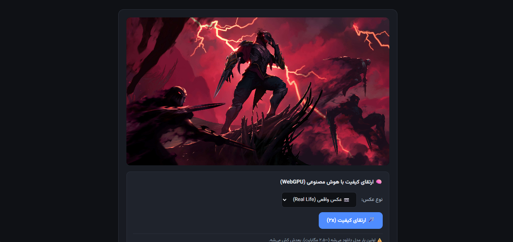
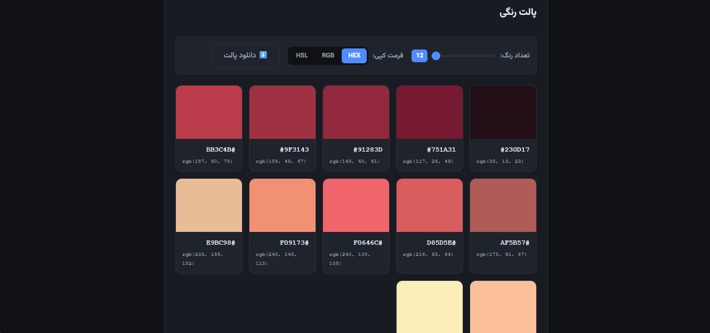
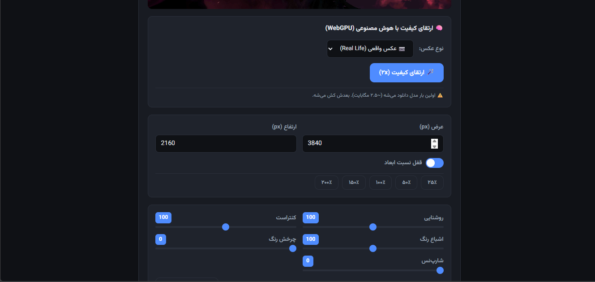

<div align="center">

# 🎨 Color Palette Extractor

### استخراج پالت رنگ + ارتقای کیفیت عکس با هوش مصنوعی

افزونه‌ای سبک، آفلاین و کاملاً رایگان برای Chrome — بدون نیاز به سرور، بدون ارسال داده به بیرون.

[](https://developer.chrome.com/docs/extensions/mv3/)
[](https://www.w3.org/TR/webgpu/)
[](LICENSE)
[]()

<br>


</div>

---

## ✨ چرا این افزونه؟

<table>
<tr>
<td width="50%">

### 🎯 ساده و سریع
- رابط کاربری تمیز و راست‌چین
- Drag & Drop برای آپلود عکس
- پیش‌نمایش زنده با هر تغییر

</td>
<td width="50%">

### 🔒 کاملاً خصوصی
- بدون سرور، بدون API خارجی
- هیچ داده‌ای از دستگاهت خارج نمی‌شه
- کاملاً آفلاین کار می‌کنه

</td>
</tr>
<tr>
<td width="50%">

### 🧠 هوش مصنوعی
- ارتقای کیفیت عکس با WebSR
- شتاب‌دهی با WebGPU
- دو مدل جدا برای عکس واقعی و کارتونی

</td>
<td width="50%">

### 💰 رایگان و متن‌باز
- بدون اشتراک، بدون تبلیغ
- سورس‌کد کاملاً در دسترس
- قابل نصب به صورت Unpacked

</td>
</tr>
</table>

---

## 🚀 قابلیت‌ها

### 🎨 استخراج پالت رنگ
- استخراج هوشمند رنگ‌های اصلی با الگوریتم **Median Cut**
- انتخاب تعداد رنگ (۳ تا ۱۲)
- کپی سریع با فرمت **HEX** / **RGB** / **HSL**
- دانلود پالت به صورت تصویر **PNG**

### 🎛️ فیلترهای تصویری
| فیلتر | بازه | توضیح |
|-------|------|-------|
| ☀️ روشنایی | 0-200 | تنظیم نور عکس |
| 🌗 کنتراست | 0-200 | افزایش تفاوت رنگ‌ها |
| 🌈 اشباع رنگ | 0-200 | شدت رنگ‌ها |
| 🎨 چرخش رنگ | 0-360 | تغییر کل hue عکس |
| 🔪 شارپ‌نس | 0-100 | تیز کردن لبه‌ها |
| ⚫ سیاه و سفید | On/Off | تبدیل به Grayscale |

### 📐 تغییر اندازه
- تنظیم دستی عرض و ارتفاع
- قفل نسبت ابعاد (Aspect Ratio)
- پریست‌های آماده: ۲۵٪ / ۵۰٪ / ۱۰۰٪ / ۱۵۰٪ / ۲۰۰٪

### 🪄 ارتقای کیفیت (Upscale)
- پردازش با **WebSR** روی **WebGPU**
- دو مدل بهینه:
  - 🎨 `Anime4K` برای کارتونی و انیمه
  - 📷 `Real-Life` برای عکس‌های واقعی
- بزرگ‌نمایی ۲ برابر بدون افت کیفیت

---

## 📸 تصاویر

<div align="center">

### رابط اصلی





### پالت رنگ استخراج‌شده





### ارتقای کیفیت با AI




</div>


---

## 📥 نصب

### 🔧 نصب برای کاربران عادی

<details>
<summary><b>روش ۱: نصب دستی از سورس (توصیه‌شده)</b></summary>

<br>

**قدم ۱:**کل فایل رو دانلود کنید در مروگر  وارد بخش اکستنشن شوید Developer mode رو on کنید Load unpacked رو بزنید پوشه رو قرار بدید  و از اکستنشن ها بهش دسرسی خواهید داشت 
 

**قدم 2:** پوشه‌ی پروژه رو دانلود یا Clone کن:

```bash
git clone https://github.com/YOUR-USERNAME/color-palette-extension.git
cd color-palette-extension